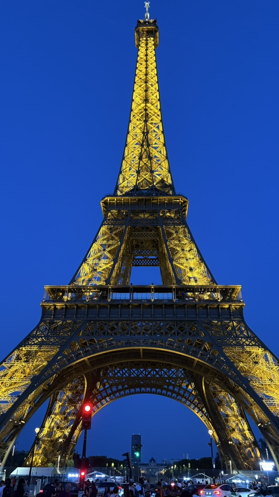
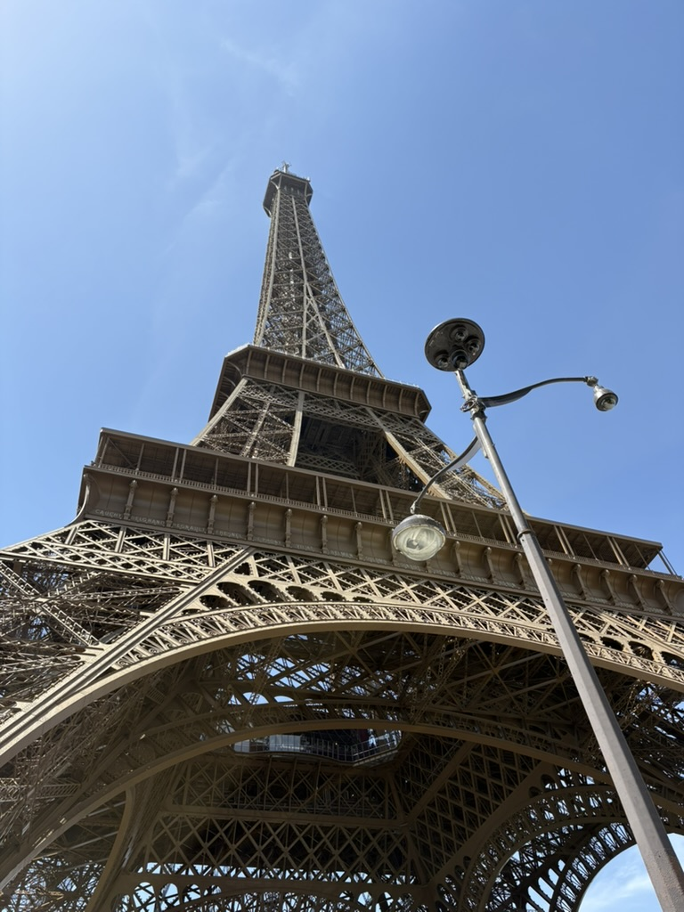
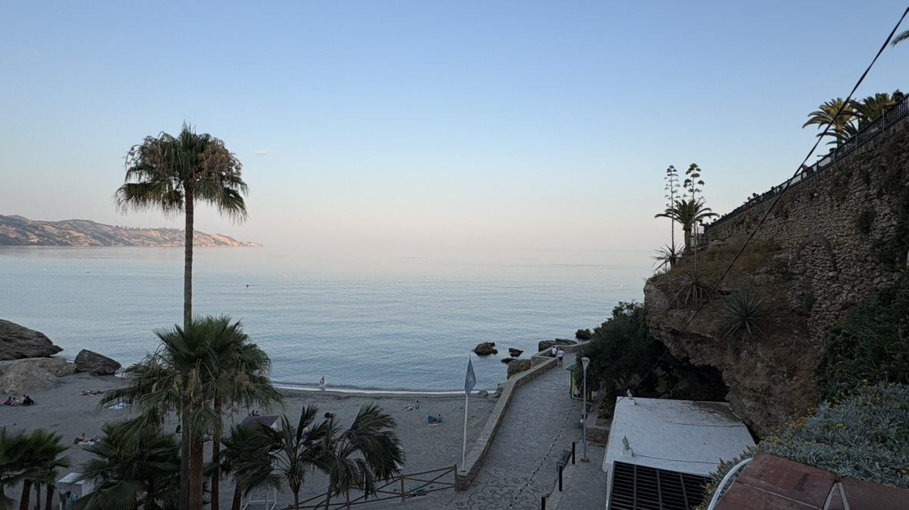
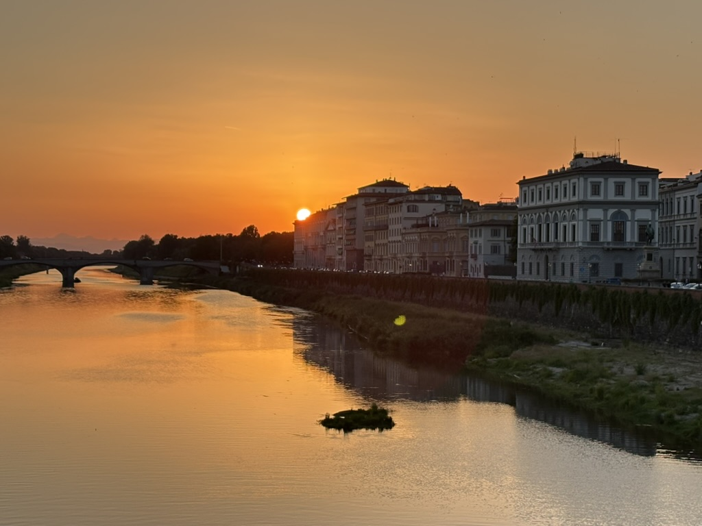
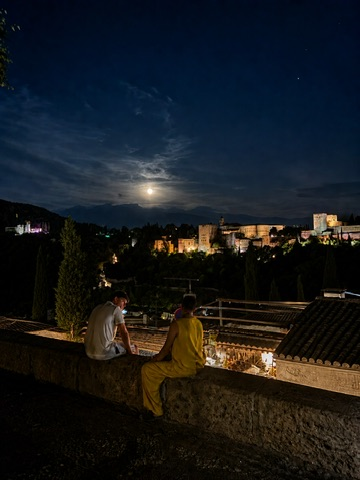
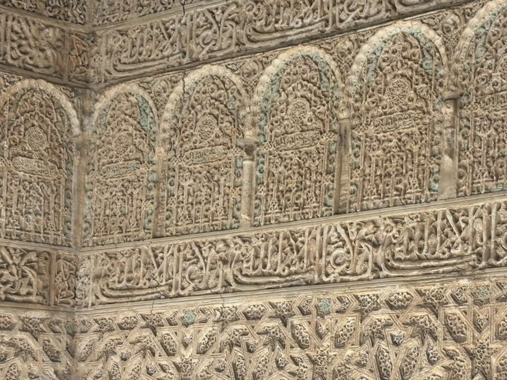

[Regresar]({{ '/' | relative_url }})

<h3>La Torre en Paris de noche</h3>

<h3>La Torre en Paris primera vista</h3>

<h3>El balcón de Europa en España</h3>

<h3>Atardecer en Florencia</h3>

<h3>La Luna desde la Alhambra</h3>

<h3>Detalle en la Alhambra</h3>

<h3>Retablo dorado</h3>

<h3>El Oso y el Madroño en Madrid</h3>

<h3>Casa Batlló en Barcelona</h3>

<h3>El crucifijo de la Sagrada Familia</h3>

<h3>Murallas entre cipreses</h3>

<h3>Portada gótica</h3>

<h3>Fachada de la Sagrada Familia</h3>

<h3>Relieves de la fachada de la Pasión</h3>

<h3>Una calle del casco histórico</h3>

<h3>Puerta de Alcalá en Madrid</h3>

<h3>Costa de Barcelona</h3>

<h3>Real Academia Española</h3>

<h3>Bóvedas de la Sagrada Familia</h3>

[Regresar]({{ '/' | relative_url }})
